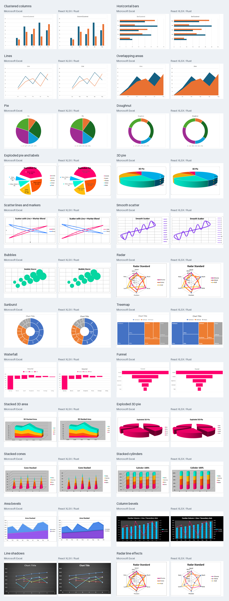
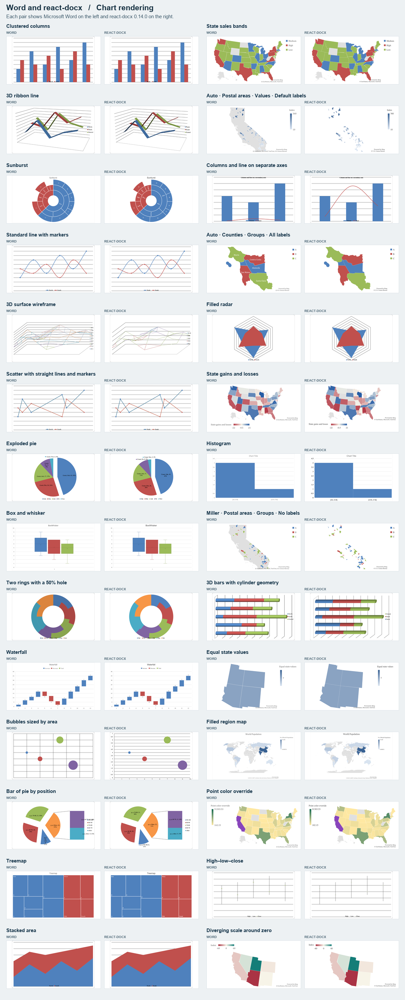
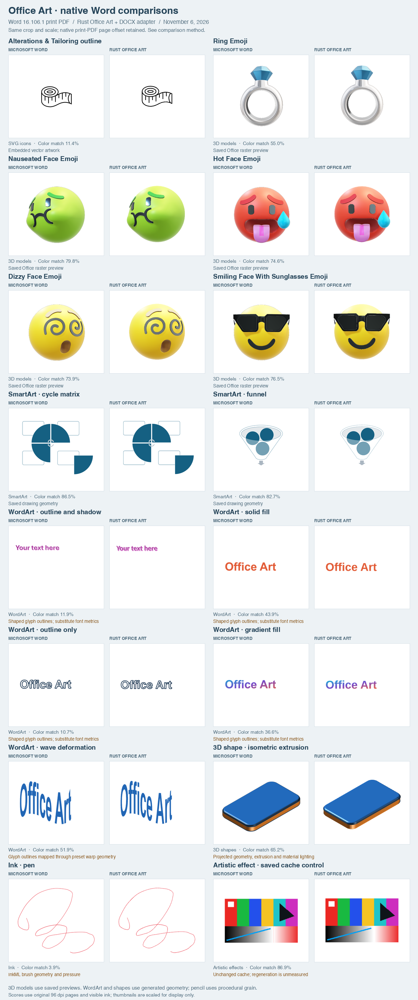
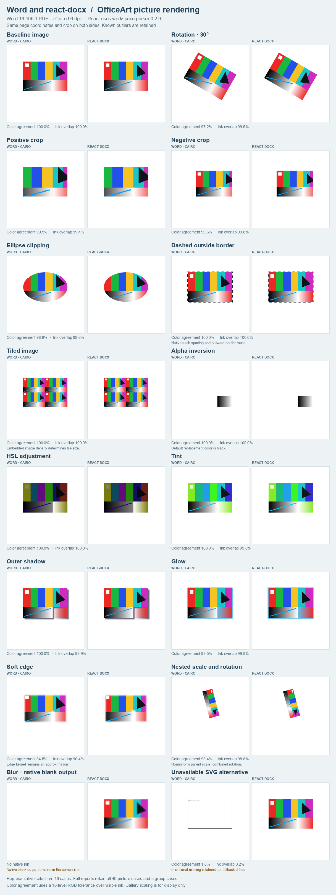
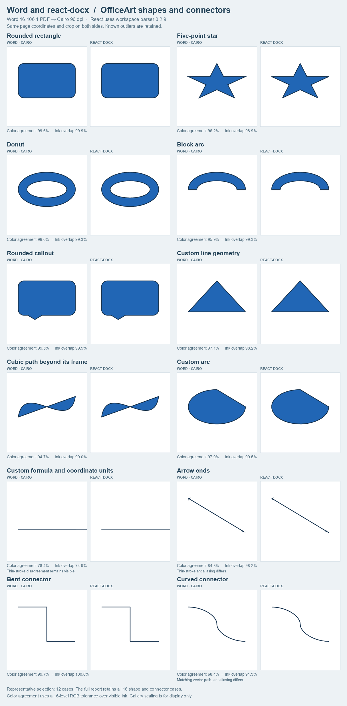
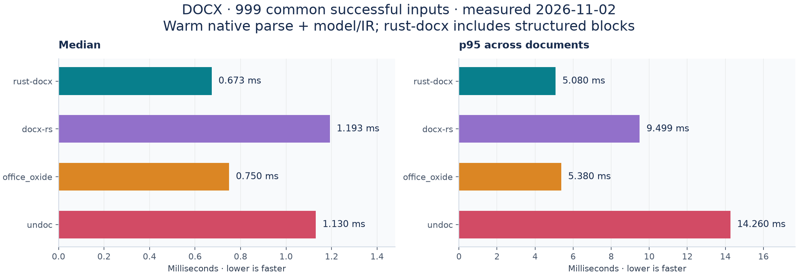
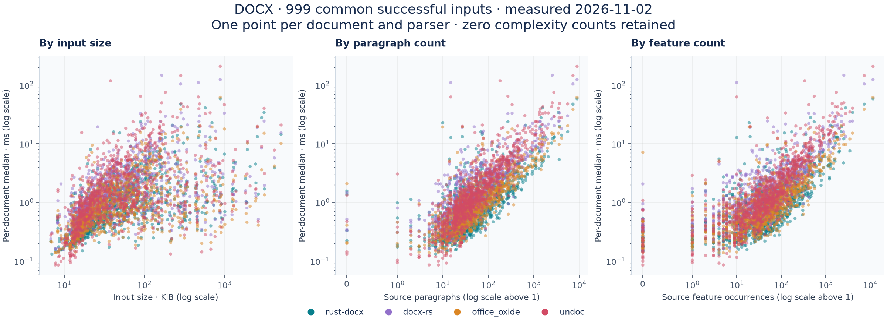
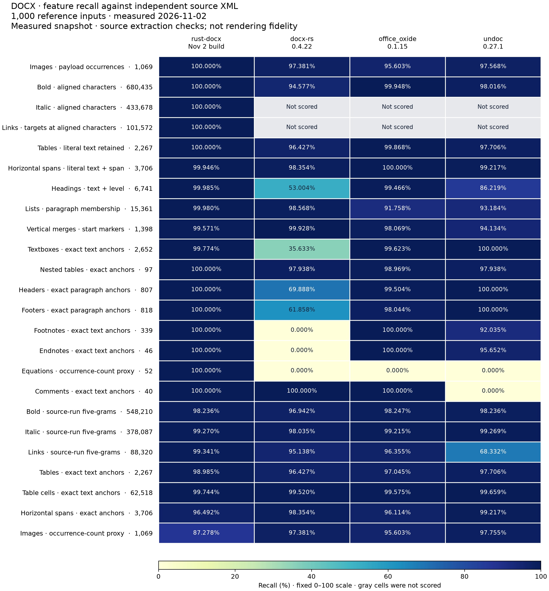
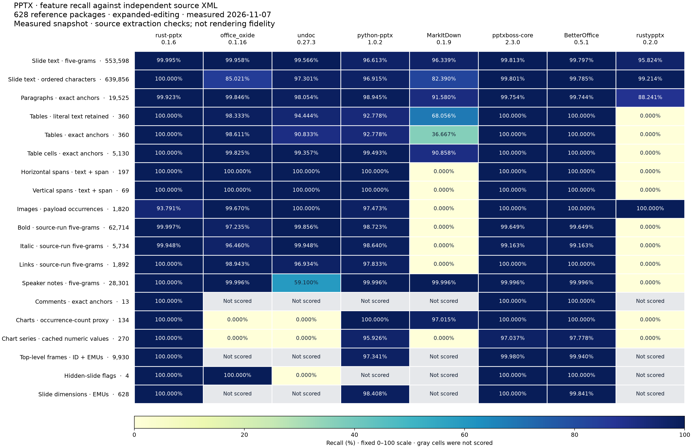

# Rust Office

[](https://github.com/extend-hq/rust-office/actions/workflows/check.yml) [](LICENSE)

Rust parsers for Word and PowerPoint, shared Office chart and artwork rendering, and browser WASM bindings. Powers [React DOCX](https://github.com/extend-hq/react-docx), [React XLSX](https://github.com/extend-hq/react-xlsx), and [React PPTX](https://github.com/extend-hq/react-pptx). XLSX workbook parsing and calculation use DukeSheets in React XLSX.

## Packages

| Crate | Purpose | Version | Downloads | API docs |
| --- | --- | --- | --- | --- |
| [rust-office-charts](crates/rust-office-charts) | Render Office chart definitions to SVG | [](https://crates.io/crates/rust-office-charts) | [](https://crates.io/crates/rust-office-charts) | [](https://docs.rs/rust-office-charts) |
| [rust-office-art](crates/rust-office-art) | Render Office pictures, shapes and connectors | [](https://crates.io/crates/rust-office-art) | [](https://crates.io/crates/rust-office-art) | [](https://docs.rs/rust-office-art) |
| [rust-office-charts-wasm](crates/rust-office-charts-wasm) | WebAssembly bindings for Office chart rendering | [](https://crates.io/crates/rust-office-charts-wasm) | [](https://crates.io/crates/rust-office-charts-wasm) | [](https://docs.rs/rust-office-charts-wasm) |
| [rust-docx](crates/rust-docx) | Parse Word documents into a structured document model | [](https://crates.io/crates/rust-docx) | [](https://crates.io/crates/rust-docx) | [](https://docs.rs/rust-docx) |
| [rust-docx-wasm](crates/rust-docx-wasm) | WebAssembly bindings for the Word parser | [](https://crates.io/crates/rust-docx-wasm) | [](https://crates.io/crates/rust-docx-wasm) | [](https://docs.rs/rust-docx-wasm) |
| [rust-pptx](crates/rust-pptx) | Parse PowerPoint presentations into a structured slide model | [](https://crates.io/crates/rust-pptx) | [](https://crates.io/crates/rust-pptx) | [](https://docs.rs/rust-pptx) |
| [rust-pptx-wasm](crates/rust-pptx-wasm) | WebAssembly bindings for the PowerPoint parser | [](https://crates.io/crates/rust-pptx-wasm) | [](https://crates.io/crates/rust-pptx-wasm) | [](https://docs.rs/rust-pptx-wasm) |

Install native parsers with `cargo add rust-docx` or `cargo add rust-pptx`; their Rust imports are `rust_docx` and `rust_pptx`. Each crate's README contains usage and API details.

For browser charts, install `@extend-ai/rust-office-charts`:

```js
import { loadOfficeCharts } from "@extend-ai/rust-office-charts/full";

const renderer = await loadOfficeCharts();
const svg = renderer.renderChart(chartXml, options);
```

The default entry includes 2D bar, line, area and scatter charts; `/full` adds the other supported families. Unsupported layouts can return `null`. [Office fonts](packages/office-fonts) load separately from chart WASM.

## Development

```bash
rustup target add wasm32-unknown-unknown
cargo test --workspace --locked
cargo check --workspace --locked --target wasm32-unknown-unknown
npm run check:browser
```

CI uses Rust 1.93.1 and Node.js 24. Install `wasm-pack` and run `npm run build:browser` after changing chart WASM sources; see the [release guide](RELEASING.md) for generated assets and versioning.

| Work | Start here |
| --- | --- |
| Word parsing, source references and serialization | [rust-docx](crates/rust-docx), [structured export](docs/structured-export.md) |
| PowerPoint parsing and slide models | [rust-pptx](crates/rust-pptx) |
| Shared chart and artwork rendering | [rust-office-charts](crates/rust-office-charts), [rust-office-art](crates/rust-office-art), [art architecture](docs/office-art-architecture.md) |
| Browser loaders and generated chart WASM | [browser](browser), [chart WASM bindings](crates/rust-office-charts-wasm) |
| Benchmarks and visual comparisons | [DOCX parser tools](scripts/parser-benchmark/README.md), [PPTX parser tools](scripts/pptx-benchmark/README.md), [chart tools](scripts/chart-fidelity/README.md), [art tools](scripts/image-fidelity/README.md) |
| Versions and publication from main | [Release guide](RELEASING.md) |

Parser and shared renderer fixes belong here; React layout and interaction changes belong in the viewer repositories. Rust crates and npm packages have independent versions.

## Packages, benchmarks, and chart accuracy

Retained captures below identify their measured versions and dates. They do not establish current-release parity with Microsoft Office.

### Excel charts

[](docs/excel-chart-comparisons.md)

November 5, 2026: **382/382 charts rendered across 43 workbooks**, with **381 native Excel reference pairs** and 48 gallery cases. Lighting, label placement and map geometry still differ.

| Gallery | Examples |
| --- | ---: |
| [Bars, lines, areas and secondary axes](docs/readme-assets/excel-chart-bars-lines-areas.png) | 8 |
| [Pies, exploded slices and multiple rings](docs/readme-assets/excel-chart-pies-and-rings.png) | 8 |
| [Scatter, bubbles, radar, error bars and stock](docs/readme-assets/excel-chart-scatter-radar-stock.png) | 8 |
| [Modern charts and filled maps](docs/readme-assets/excel-chart-modern-charts.png) | 8 |
| [3D areas, pies, cones, cylinders, pyramids and surfaces](docs/readme-assets/excel-chart-three-dimensional.png) | 8 |
| [Shadows, bevels, labels and trendline equations](docs/readme-assets/excel-chart-formatting-and-effects.png) | 8 |

[Method and limitations](docs/excel-chart-comparisons.md) · [Measurements](docs/readme-assets/excel-chart-comparison.csv) · [Provenance](docs/readme-assets/excel-chart-provenance.json)

### Word charts

[](docs/readme-assets/word-chart-overview.png)

November 4, 2026, React DOCX 0.14.0: **155/157 charts rendered**; two volume-stock combinations produced no image. The overview shows 28 pairs; the galleries retain every case. Ink overlap measures shared visible ink; color match requires RGB agreement within 16 levels per channel over the ink union.

| Chart group | Viewer images | Median ink overlap | Median color match |
| --- | ---: | ---: | ---: |
| [Bars, lines, areas and pies](docs/readme-assets/word-chart-bars-lines-areas-and-pies.png) | 20/20 | 96.8% | 77.2% |
| [Scatter, bubble, radar and stock](docs/readme-assets/word-chart-scatter-bubble-radar-and-stock.png) | 15/17 | 88.0% | 46.9% |
| [3D columns, bars, areas and lines](docs/readme-assets/word-chart-3d-columns-bars-areas-and-lines.png) | 19/19 | 68.3% | 39.3% |
| [Surfaces and split pies](docs/readme-assets/word-chart-surfaces-and-split-pies.png) | 13/13 | 96.0% | 88.8% |
| [Axes, statistics and missing data](docs/readme-assets/word-chart-axes-statistics-and-missing-data.png) | 21/21 | 82.1% | 62.5% |
| [Fills, colors and markers](docs/readme-assets/word-chart-fills-colors-and-markers.png) | 12/12 | 98.6% | 49.9% |
| [Modern charts and filled maps](docs/readme-assets/word-chart-modern-charts-and-filled-maps.png) | 8/8 | 95.3% | 94.7% |
| [Map areas and projections](docs/readme-assets/word-chart-map-areas-and-projections.png) | 24/24 | 86.3% | 82.5% |
| [Map data and styling](docs/readme-assets/word-chart-map-data-and-styling.png) | 16/16 | 95.7% | 92.6% |
| [Independent Open XML SDK sample](docs/readme-assets/word-chart-independent-open-xml-sdk-sample.png) | 7/7 | 56.2% | 39.3% |

[Method and limitations](docs/chart-comparisons.md) · [Measurements](docs/readme-assets/word-chart-comparison.csv)

### Office Art

[](docs/office-art-comparisons.md)

November 6, 2026: **30 cases** through the native DOCX adapter. 3D models use saved Office previews; SmartArt uses saved drawing trees. WordArt, projected 3D shapes and ink are rendered, with remaining font, warp, shading and texture differences. Artistic-effect controls measure cache preservation.

| Gallery | Cases |
| --- | ---: |
| [3D models, emoji and SmartArt](docs/readme-assets/word-officeart-expanded-models-and-smartart.png) | 7 |
| [WordArt, warped text, extrusion, bevels and materials](docs/readme-assets/word-officeart-expanded-wordart-and-3d.png) | 12 |
| [SVG icons, shapes, ink and cached artistic effects](docs/readme-assets/word-officeart-expanded-icons-shapes-and-ink.png) | 11 |

[Method and gaps](docs/office-art-comparisons.md) · [Measurements](docs/readme-assets/word-officeart-expanded-comparison.csv) · [Provenance](docs/readme-assets/word-officeart-expanded-provenance.json)

[](docs/readme-assets/word-officeart-overview.png)

[](docs/readme-assets/word-officeart-shapes.png)

November 5, 2026, workspace DOCX/WASM 0.2.9 candidate: **61 controlled picture, group and shape cases**, compared at fixed native page coordinates.

| Matrix | Cases at 96% color agreement | Median | All-case mean |
| --- | ---: | ---: | ---: |
| [Pictures and effects](docs/readme-assets/word-picture-comparison.csv) | 37/40 | 100.00% | 94.11% |
| [Group transforms](docs/readme-assets/word-group-comparison.csv) | 4/5 | 98.55% | 97.67% |
| [Shapes and connectors](docs/readme-assets/word-shape-comparison.csv) | 10/16 | 97.51% | 93.78% |

Color agreement uses the visible-ink union. The 96–97% target is not met across all cases. A separate full-document check of **123 drawings** reaches **50.00% mean agreement**, with **0/123 at 96%**; another **206 drawings lack native references**.

[Coverage and method](docs/picture-coverage.md) · [Document measurements](docs/readme-assets/word-art-document-comparison.csv) · [Document provenance](docs/readme-assets/word-art-document-provenance.json) · [SmartArt coverage](docs/smartart-coverage.md) · [Manual fixtures and tools](scripts/image-fidelity/README.md)

### DOCX parser benchmarks

November 2, 2026: **1,000 documents**, with latency measured on the **999 inputs completed by all four parsers**. Native parsing/model construction excludes file reads, startup, serialization and browser layout. Each point represents a document's median warm parse time; p95 is across those medians.





Text and feature scores use independent source-XML references; they measure extraction, not rendering fidelity. A separate 25-document Word reference sample is included in the full report.

[](docs/readme-assets/docx-optimized-20261102-feature-recall.png)

Each cell is recall against the independent source-XML reference on all 1,000 inputs, on a fixed 0–100% scale. Gray cells are checks a parser's output model cannot express. rust-docx (November 2 build) leads or ties on 18 of 24 checks. Its largest gaps are the image occurrence-count proxy (87.278%; payload-matched images reach 100.000%) and exact horizontal-span anchors (96.492%).

[Results, feature recall and methodology](docs/docx-benchmarks.md) · [Benchmark tools](scripts/parser-benchmark/README.md) · [Source-reference data](crates/rust-docx/benchmarks/optimized-20261102/accuracy.json) · [Word-reference data](crates/rust-docx/benchmarks/word-reference-20261103/summary.json)

### PPTX parser benchmarks

[](docs/readme-assets/pptx-expanded-editing-20261107-feature-recall.png)

November 7, 2026, rust-pptx 0.1.6: **eight parsers on 630 OOXML inputs**, scored against **628 independent source-XML references**. Each cell is recall on a fixed 0–100% scale; failed parses count as zero, and gray cells are checks a parser's output model cannot express. These measure extraction, not rendering fidelity.

rust-pptx leads or ties on 18 of 19 checks. Image payload occurrences reach 93.791%: all 113 misses are pictures with a preferred SVG alternative, where rust-pptx selects the SVG and retains the fallback bitmap separately, while the reference counts only the primary blip.

[Specification audit, timing and methodology](docs/pptx-parser-audit.md) · [Benchmark tools](scripts/pptx-benchmark/README.md) · [Measurements](docs/readme-assets/pptx-expanded-editing-20261107-feature-recall.csv) · [Provenance](docs/readme-assets/pptx-expanded-editing-20261107-feature-recall.json)

## License

[MIT](LICENSE). Bundled dependencies and data have additional [notices](THIRD-PARTY-NOTICES.txt), [font licenses](FONT-DATA-LICENSE), and [map licenses](MAP-DATA-LICENSE); check individual crates for their notices.
