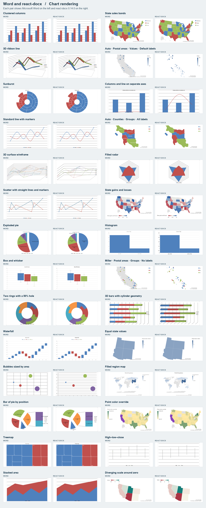

# Native chart rendering compared with Word

The gallery compares **157 chart drawings** with Microsoft Word for Mac. It includes 110 charts from a chart family atlas, 40 additional map configurations, and seven charts from an independent Open XML SDK document. Viewer **0.14.0** produced a native chart image for **155 of 157**. The two volume-stock combinations produced no image.

The overview shows 28 pairs. The galleries below include every measured case, including the missing images. **Ink overlap** measures the share of visible ink that lands in the same place in both images. **Color match** measures the share of that same area whose RGB values agree within 16 levels per channel. Both scores include titles, axes and legends.

| Chart group | Viewer images | Median ink overlap | Median color match |
| --- | ---: | ---: | ---: |
| [Bars, lines, areas and pies](../docs/readme-assets/word-chart-bars-lines-areas-and-pies.png) | 20/20 | 96.8% | 77.2% |
| [Scatter, bubble, radar and stock](../docs/readme-assets/word-chart-scatter-bubble-radar-and-stock.png) | 15/17 | 88.0% | 46.9% |
| [3D columns, bars, areas and lines](../docs/readme-assets/word-chart-3d-columns-bars-areas-and-lines.png) | 19/19 | 68.3% | 39.3% |
| [Surfaces and split pies](../docs/readme-assets/word-chart-surfaces-and-split-pies.png) | 13/13 | 96.0% | 88.8% |
| [Axes, statistics and missing data](../docs/readme-assets/word-chart-axes-statistics-and-missing-data.png) | 21/21 | 82.1% | 62.5% |
| [Fills, colors and markers](../docs/readme-assets/word-chart-fills-colors-and-markers.png) | 12/12 | 98.6% | 49.9% |
| [Modern charts and filled maps](../docs/readme-assets/word-chart-modern-charts-and-filled-maps.png) | 8/8 | 95.3% | 94.7% |
| [Map areas and projections](../docs/readme-assets/word-chart-map-areas-and-projections.png) | 24/24 | 86.3% | 82.5% |
| [Map data and styling](../docs/readme-assets/word-chart-map-data-and-styling.png) | 16/16 | 95.7% | 92.6% |
| [Independent Open XML SDK sample](../docs/readme-assets/word-chart-independent-open-xml-sdk-sample.png) | 7/7 | 56.2% | 39.3% |

The map cases cover countries, states, counties and ZIP areas, numeric and categorical fills, several projections, missing values, point colors, and legend positions. The SDK sample preserves Word’s two-column page clipping. [Download all per-chart measurements](../docs/readme-assets/word-chart-comparison.csv) or [open the independent source document](https://github.com/dotnet/Open-XML-SDK/blob/main/test/DocumentFormat.OpenXml.Tests.Assets/assets/TestDataStorage/v2FxTestFiles/wordprocessing/chart/chart2.docx).

How the comparison was measured

Measured November 4, 2026 with the npm 0.14.0 release source at [a922790](https://github.com/extend-hq/react-docx/commit/a922790953405df58e3309eb0809816538aac241). Microsoft Word exported each source DOCX to PDF. Its chart frame and the DOCX drawing extent set the crop. Chromium parsed the same DOCX through the viewer’s public import API and rasterized its chart SVG at the document dimensions. Both sides use 192 dpi. The SDK comparison uses the same visible portion of the chart on both sides.

A pixel counts as ink when any RGB channel is below 242. Both scores use the union of the two ink masks as their denominator, so white margins do not inflate agreement. Each chart contributes one score to its group median. A missing chart scores zero. The thumbnails are reduced after scoring. Fonts and antialiasing can affect results.

