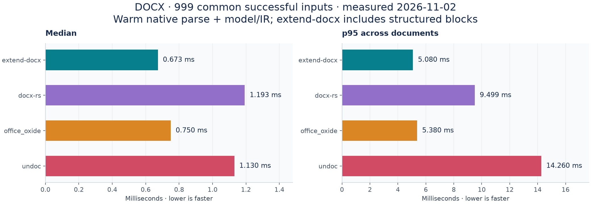
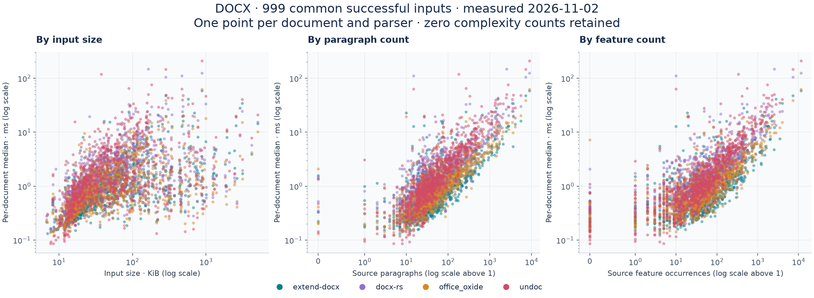
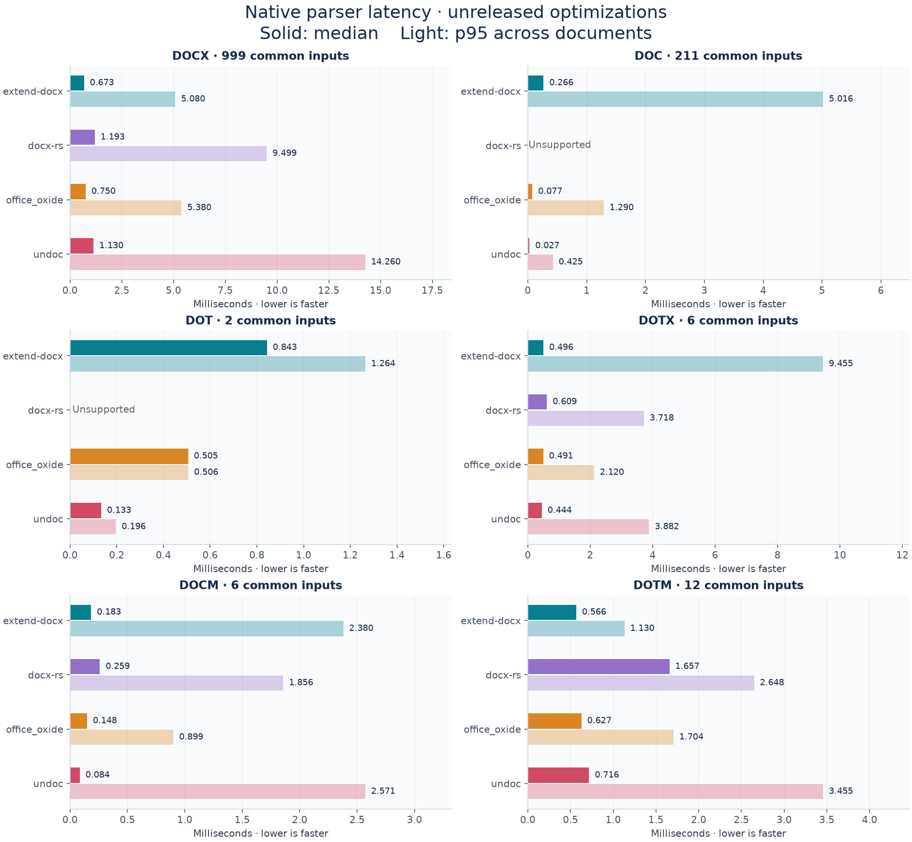
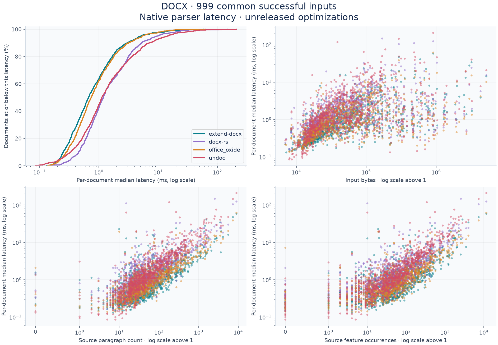
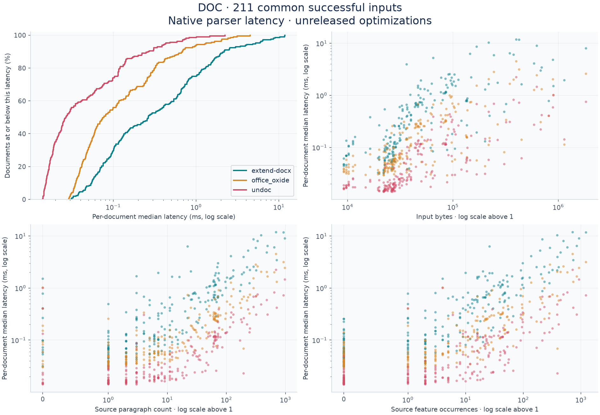
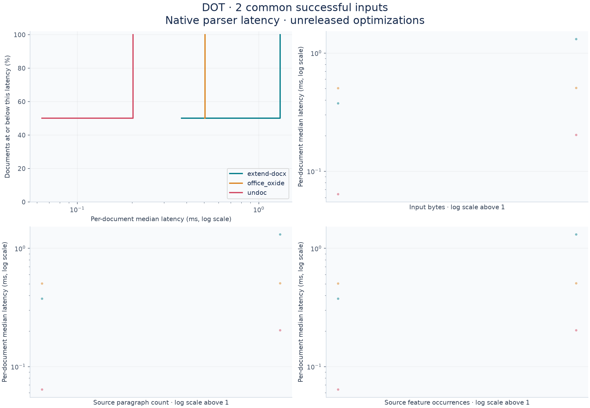
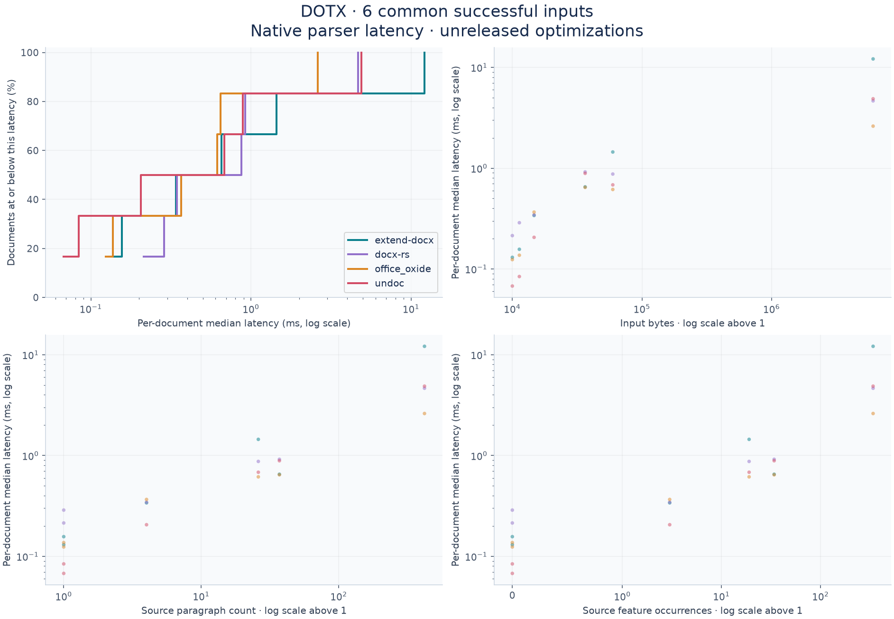
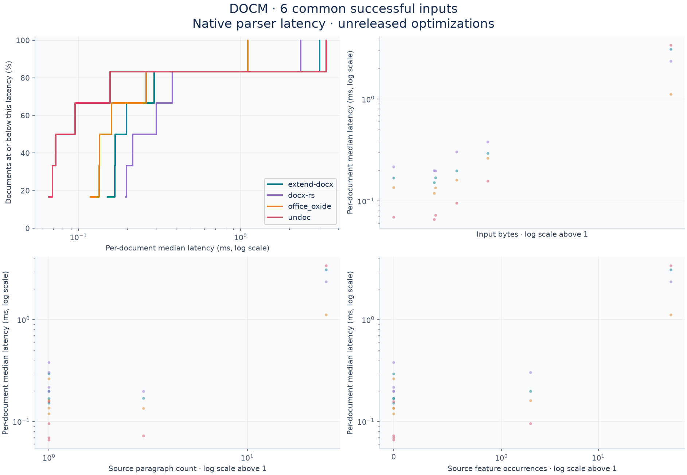
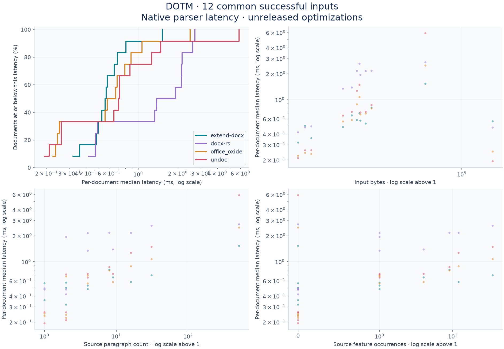
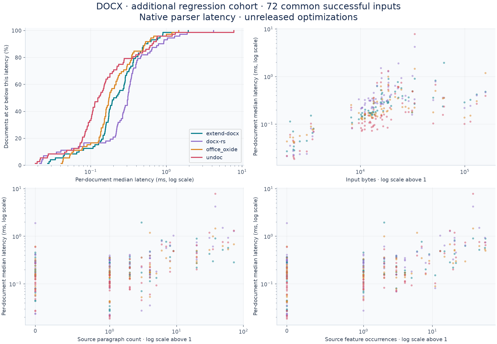

# DOCX parser benchmarks


The native Rust parser is **extend-docx**, also used by the JavaScript package through WebAssembly. It builds an editable document model and structured blocks with source references. The comparisons below measure native parsing and extraction; browser loading, layout, pagination, and editing are outside the timing scope.

### DOCX latency and text accuracy

Measured **November 2, 2026**, on a seeded **1,000-document DOCX corpus**. Latency uses the **999 inputs all four parsers completed**; accuracy includes every reference-bearing input and counts parser failures as zero. Comparison versions: docx-rs **0.4.22**, office_oxide **0.1.15**, undoc **0.27.1**.

| Parser | Parsed | Median | p95 | Body-text F1 | Ordered-text F1 |
| --- | ---: | ---: | ---: | ---: | ---: |
| extend-docx | 1,000/1,000 | 0.673 ms | 5.080 ms | 99.983% | 99.995% |
| docx-rs | 999/1,000 | 1.193 ms | 9.499 ms | 99.740% | 99.747% |
| office_oxide | 1,000/1,000 | 0.750 ms | 5.380 ms | 99.917% | 99.926% |
| undoc | 1,000/1,000 | 1.130 ms | 14.260 ms | 99.988% | 99.975% |



Extend-docx has the lowest median and p95 in this run. Its median is 10.3% lower than office_oxide's; this does **not** establish a 5× speedup. Undoc has the highest five-gram text F1, while extend-docx has the highest ordered-text F1.

Each document has five warm samples, each averaging 1–20 parses. Timings include parsing and native model/IR construction; extend-docx also projects structured blocks. File reads, process startup, JSON serialization, object destruction, and reference generation are excluded. The p95 is across document medians. Results come from a shared development machine and the libraries retain different amounts of structure.

### Latency by document size and complexity

The same 999 successful inputs appear for every library. Each point is one document's median latency. Complexity counts come from the source reference and are shared across parsers. Logarithmic axes retain zero complexity counts.



### Feature recall on 1,000 DOCX inputs

These are **recall checks against an independent source-XML extractor**, not universal accuracy or Word rendering scores. Image occurrences match retained payload bytes and multiplicity. Literal table/span checks allow additional output characters; exact-anchor checks remain separately available. Positive explicit-formatting recall does not establish precision or inherited-style correctness.

| Check | Expected units | extend-docx | docx-rs | office_oxide | undoc |
| --- | ---: | ---: | ---: | ---: | ---: |
| Images · payload-matched occurrences | 1,069 | 100.000% | 97.381% | 95.603% | 97.568% |
| Explicit bold · aligned characters | 680,435 | 100.000% | 94.577% | 99.948% | 98.016% |
| Tables · literal text retained | 2,267 | 100.000% | 96.427% | 99.868% | 97.706% |
| Horizontal spans · literal text + exact span | 3,706 | 99.946% | 98.354% | 100.000% | 99.217% |
| Headings · text + level | 6,741 | 99.985% | 53.004% | 99.466% | 86.219% |
| Lists · paragraph membership | 15,361 | 99.980% | 98.568% | 91.758% | 93.184% |
| Vertical merges · start markers | 1,398 | 99.571% | 99.928% | 98.069% | 94.134% |
| Textboxes · exact text anchors | 2,652 | 99.774% | 35.633% | 99.623% | 100.000% |

<details>
<summary>All remaining source-reference feature checks</summary>

| Check | Expected units | extend-docx | docx-rs | office_oxide | undoc |
| --- | ---: | ---: | ---: | ---: | ---: |
| Tables · exact text anchors | 2,267 | 98.985% | 96.427% | 97.045% | 97.706% |
| Table cells · exact text anchors | 62,518 | 99.744% | 99.520% | 99.575% | 99.659% |
| Nested tables · text anchors | 97 | 100.000% | 97.938% | 98.969% | 97.938% |
| Horizontal spans · exact text + span | 3,706 | 96.492% | 98.354% | 96.114% | 99.217% |
| Headers · paragraph text | 807 | 100.000% | 69.888% | 99.504% | 100.000% |
| Footers · paragraph text | 818 | 100.000% | 61.858% | 98.044% | 100.000% |
| Footnotes · paragraph text | 339 | 100.000% | 0.000% | 100.000% | 92.035% |
| Endnotes · paragraph text | 46 | 100.000% | 0.000% | 100.000% | 95.652% |
| Comments · paragraph text | 40 | 100.000% | 100.000% | 100.000% | 0.000% |
| Equations · occurrence count proxy | 52 | 100.000% | 0.000% | 0.000% | 0.000% |
| Images · node-count proxy | 1,069 | 87.278% | 97.381% | 95.603% | 97.755% |
| Explicit bold · run five-grams | 548,210 | 98.236% | 96.942% | 98.247% | 98.236% |
| Explicit italic · run five-grams | 378,087 | 99.270% | 98.035% | 99.215% | 99.269% |
| Hyperlinks · text five-grams | 88,320 | 99.341% | 95.138% | 96.355% | 68.332% |
| Explicit italic · aligned characters | 433,678 | 100.000% | Not scored | Not scored | Not scored |
| Hyperlink targets · aligned characters | 101,572 | 100.000% | Not scored | Not scored | Not scored |

Run-based checks are sensitive to segmentation and inherited formatting. Image node counts can undercount composite SVGs even when all payloads are retained. “Not scored” means that adapter has no measurement for the stated native semantic audit; the comparable five-gram rows remain above. Original measurements, precision/F1, and denominators are preserved in the aggregate data.

</details>

### Independent Microsoft Word reference sample

Measured **November 3, 2026**, on **25 documents** selected from the start of the fixed manifest without score filtering. All four parsers completed all inputs. Text uses Microsoft Word's object model; image payload checks use the original source bytes. This small sample supplements the larger XML-reference benchmark.

| Parser | Median / p95 | Word body recall | Word body F1 | Source image payloads |
| --- | ---: | ---: | ---: | ---: |
| extend-docx | 0.530 / 6.880 ms | 99.949% | 99.952% | 52/52 · 100.000% |
| docx-rs | 1.089 / 6.606 ms | 99.939% | 99.947% | 48/52 · 92.308% |
| office_oxide | 0.680 / 3.668 ms | 99.937% | 99.946% | 48/52 · 92.308% |
| undoc | 1.084 / 11.990 ms | 99.949% | 96.999% | 52/52 · 100.000% |

Extend-docx has the lowest median in this sample; office_oxide has the lowest p95. Body F1 here pools ordered character counts; it is a different metric and cohort from the macro-averaged source-XML scores above.

Each cell below is **precision / recall**. Resolved formatting covers only **10 documents** whose Word capture completed within its time budget. Native table and hyperlink references cover **24**.

| Word object-model check | extend-docx | docx-rs | office_oxide | undoc |
| --- | ---: | ---: | ---: | ---: |
| Resolved bold · 611 characters | 100.000% / 99.836% | 100.000% / 93.781% | 100.000% / 93.781% | 93.558% / 99.836% |
| Resolved italic · 387 characters | 100.000% / 100.000% | 100.000% / 88.372% | 100.000% / 100.000% | 100.000% / 100.000% |
| Top-level tables · 28 text anchors | 100.000% / 100.000% | 89.286% / 89.286% | 96.429% / 96.429% | 100.000% / 100.000% |
| Hyperlinks · 73 text anchors | 69.307% / 95.890% | 95.745% / 61.644% | 97.183% / 94.521% | 97.222% / 95.890% |

The hyperlink reference omits some field-generated links, so additional valid output can lower apparent precision. Word can normalize or repair input; its exports and the custom extractor each have limits. Neither benchmark establishes visual fidelity, exact image placement, or complete OOXML conformance.

### Other Word formats

Binary DOC and DOT use LibreOffice conversion as a reference proxy. Template/macro cohorts have only **2–12 inputs** each. The retained optimization improves DOC adaptation, but extend-docx remains slower than office_oxide and undoc on binary DOC. Macros are never executed.

<details>
<summary>All-format accuracy table and latency chart</summary>

Each cell is **body-text F1 · median / p95 milliseconds**. Accuracy and latency use the per-format scopes described above.

| Format | extend-docx | docx-rs | office_oxide | undoc |
| --- | --- | --- | --- | --- |
| DOCX | 99.983% · 0.673 / 5.080 | 99.740% · 1.193 / 9.499 | 99.917% · 0.750 / 5.380 | 99.988% · 1.130 / 14.260 |
| DOC | 98.748% · 0.266 / 5.016 | Unsupported | 97.979% · 0.077 / 1.290 | 95.293% · 0.027 / 0.425 |
| DOT | 100.000% · 0.843 / 1.264 | Unsupported | 99.902% · 0.505 / 0.506 | 100.000% · 0.133 / 0.196 |
| DOTX | 100.000% · 0.496 / 9.455 | 99.756% · 0.609 / 3.718 | 99.813% · 0.491 / 2.120 | 99.911% · 0.444 / 3.882 |
| DOCM | 100.000% · 0.183 / 2.380 | 100.000% · 0.259 / 1.856 | 100.000% · 0.148 / 0.899 | 100.000% · 0.084 / 2.571 |
| DOTM | 100.000% · 0.566 / 1.130 | 100.000% · 1.657 / 2.648 | 100.000% · 0.627 / 1.704 | 100.000% · 0.716 / 3.455 |



</details>

### Reproducibility and detailed results

- [Measured revisions, timing protocol, validation, and paired optimization results](../docs/benchmarks-optimized-20261102.md)
- [Word capture/scoring methods, coverage, and unresolved reference limitations](../docs/word-reference-benchmarks.md)
- [Source-reference accuracy aggregates](../crates/extend-docx/benchmarks/optimized-20261102/accuracy.json), [latency summary](../crates/extend-docx/benchmarks/optimized-20261102/latency.json), and [anonymous scatter data](../crates/extend-docx/benchmarks/optimized-20261102/latency.csv)
- [Word-reference aggregate precision, recall, F1, and coverage for every measured category](../crates/extend-docx/benchmarks/word-reference-20261103/summary.json)
- [Per-format distribution and complexity charts](#per-format-charts) and [historical npm 0.13.0 results](../docs/benchmarks-0.13.0.md)

These are retained completed runs, not new measurements of a documentation release. Source revisions and executable hashes identify each measured build. Historical records use the internal engine identifier `docx-core`; chart and table labels use the published crate name **extend-docx**. Public data contains aggregate counts and anonymous numeric points, without source documents or extracted text.

## Per-format charts


<details>
<summary>DOCX — seeded corpus: latency distribution and complexity</summary>



</details>

<details>
<summary>DOC: latency distribution and complexity</summary>



</details>

<details>
<summary>DOT: latency distribution and complexity</summary>



</details>

<details>
<summary>DOTX: latency distribution and complexity</summary>



</details>

<details>
<summary>DOCM: latency distribution and complexity</summary>



</details>

<details>
<summary>DOTM: latency distribution and complexity</summary>



</details>

<details>
<summary>DOCX — additional regression cohort: latency distribution and complexity</summary>



</details>

With Matplotlib and NumPy installed, regenerate charts from the published data without the original documents:

```sh
python3 scripts/parser-benchmark/readme_charts.py \
  --data crates/extend-docx/benchmarks/optimized-20261102 \
  --asset-prefix docx-core-optimized-20261102
```

## Reproduce and inspect results

See the [parser benchmark harness](../scripts/parser-benchmark/README.md) for corpus selection, scoring, native runners, and interactive reports, and the [feedback runner](../scripts/parser-feedback/README.md) for optimization experiments. Run commands from the Extend Office repository root. Private input documents, captured references, and generated run directories remain local; the committed data contains aggregate metrics and anonymous numeric points. Existing run directories can be supplied by path to the reporting commands.
