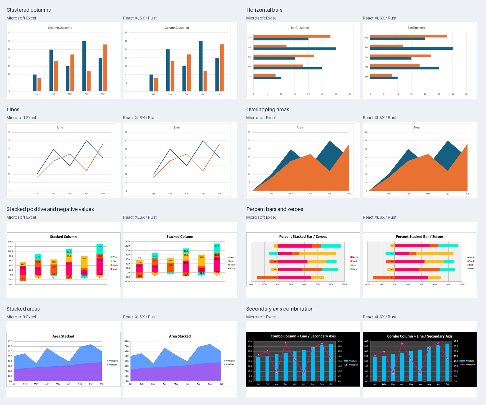
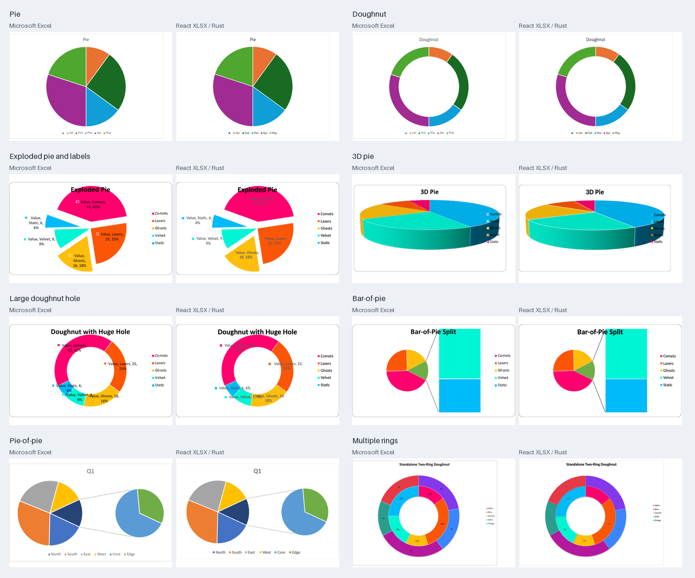
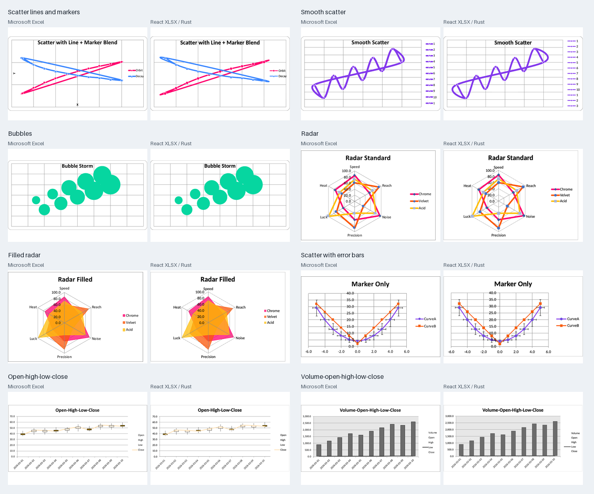
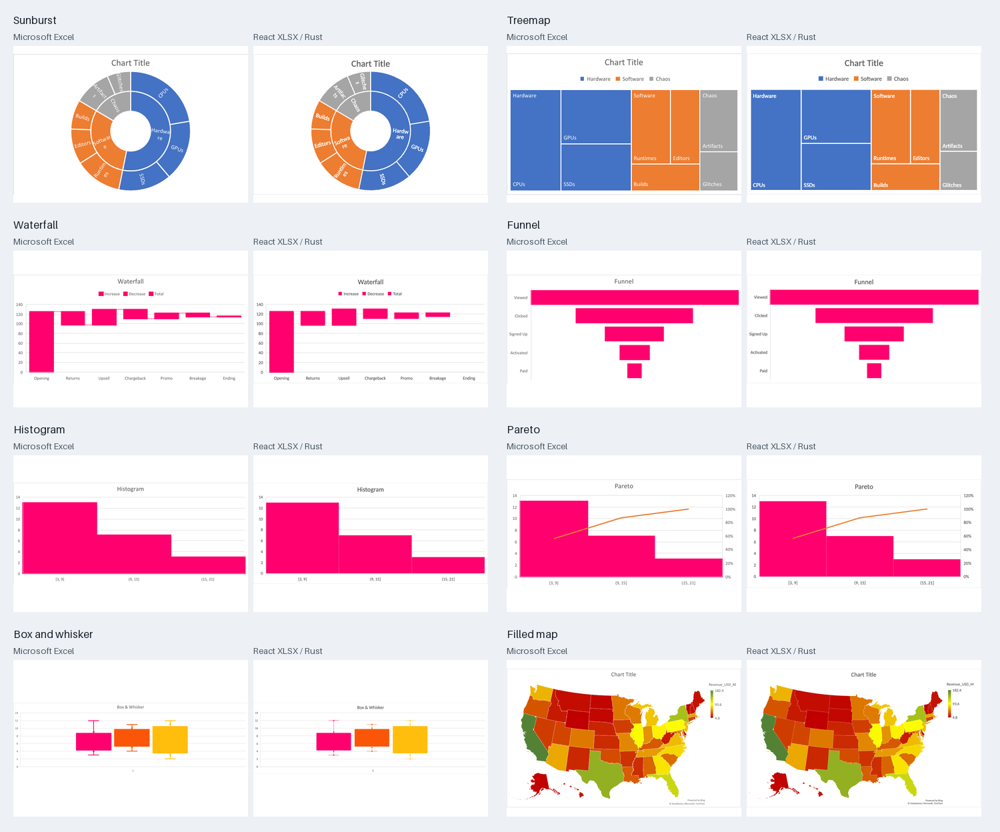
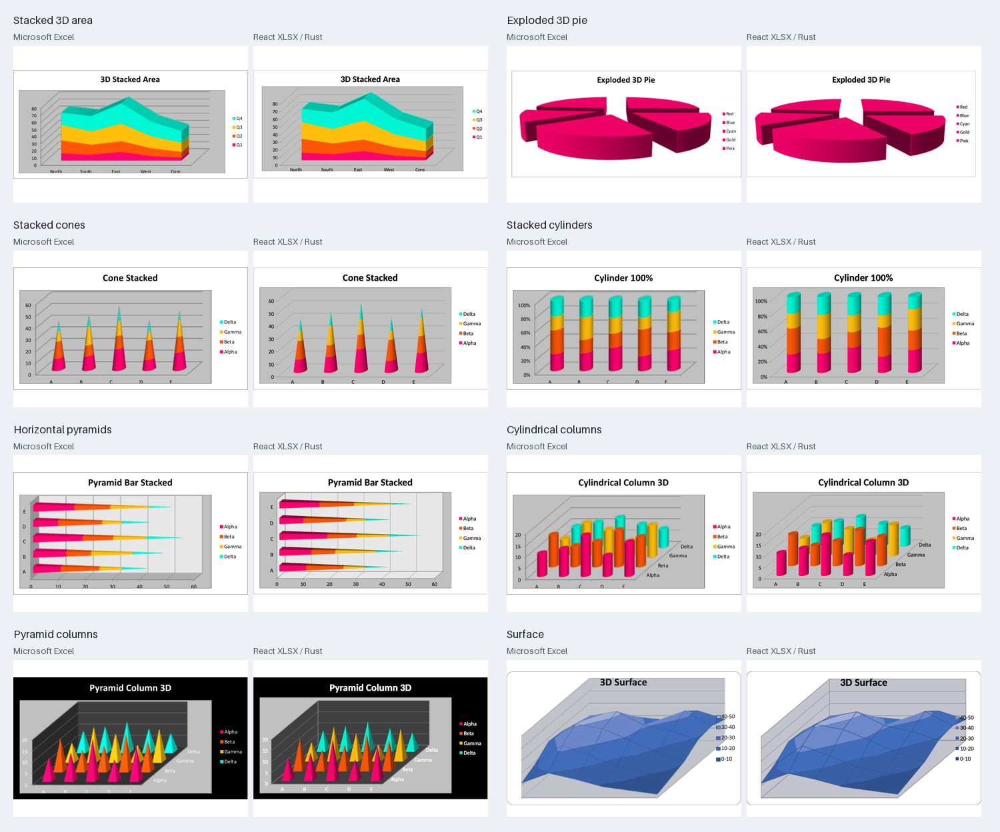
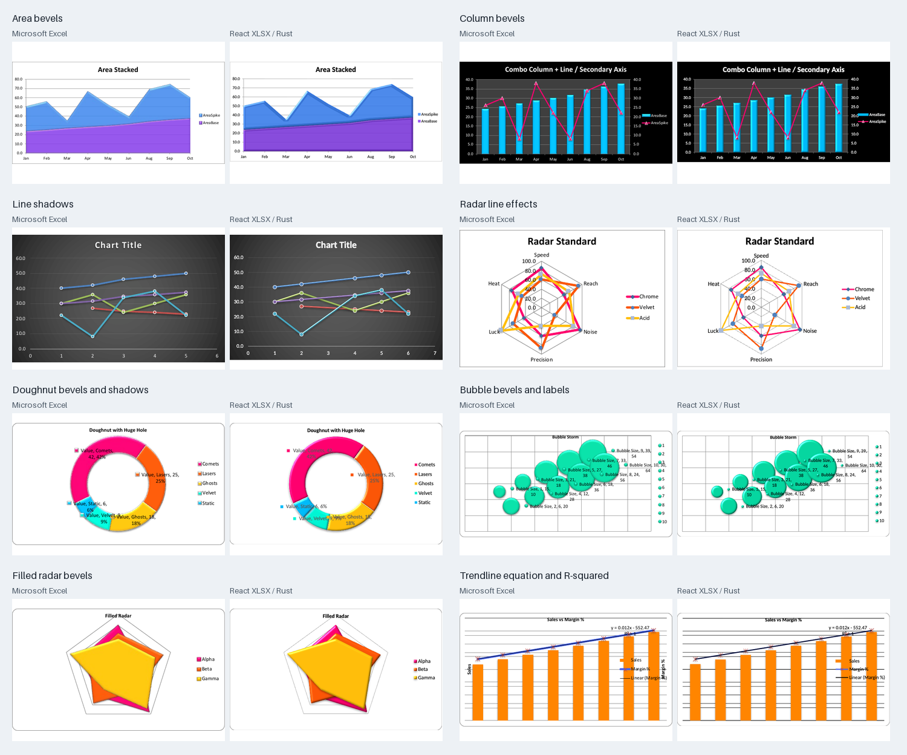

# Excel chart comparisons

The November 5, 2026 run renders 382 chart parts from 43 workbooks through the React XLSX adapter and the full Rust chart renderer. Every chart produced an image. There are 381 native Microsoft Excel for Mac image pairs; one malformed radar chart could only be inspected in Excel's live UI and is excluded from image-difference statistics.

The galleries contain 48 examples selected to cover chart families and formatting features. Excel is on the left of each pair and React XLSX / Rust on the right. Both images use the same dimensions and the same thumbnail scale; the charts are not independently stretched or aligned to improve the comparison.

## Bars, lines, areas and secondary axes



## Pies and rings



## Scatter, radar and stock



## Modern charts



## Three-dimensional charts



## Formatting and effects



## Capture method

The inventory covered 1,235 XLSX and 64 XLS inputs. The XLS inputs contained no charts. Original workbooks were unchanged. Of the paired references, 165 came from unchanged temporary copies and 216 from temporary copies with VBA components removed; chart, theme, style and data parts were unchanged. No chart references were reconstructed from renderer output.

Excel 16.107.3 was used for native captures. Excel's picture-export path can enlarge an inherited title even though the live UI uses a smaller size. Before export, the live title's existing font size was reapplied to the temporary copy. This preserved title bounds in all 381 paired references: 309 had titles and 72 had none. Exported gridlines can still differ from the live UI.

Browser captures waited for the shared font loader. The tested fallbacks were Calibri → Carlito, Arial → Arimo, Times New Roman → Tinos, Courier New → Cousine, Aptos → Intos and Aptos Narrow → Intos Narrow. Intos and Intos Narrow were subsequently removed because their provenance was unresolved. These historical measurements predate that removal and do not establish current Aptos rendering fidelity. Font outlines, shaping and vertical metrics can differ even when advances and apparent size are close.

The final mounted capture contained 710 effects across 160 charts, including 488 lighting primitives. These counts establish that effects survived the React SVG adapter; they do not establish an exact match to Excel's lighting.

## Measurements and limits

[All chart measurements](readme-assets/excel-chart-comparison.csv) include the missing native reference rather than silently dropping it. Pixel comparisons use the original dimensions, with no image registration, resizing or tolerance. The pixel-weighted mean absolute RGB error is **6.335 on a 0–255 scale** across 381 pairs. **Zero pairs are pixel-identical.** Background area, font rasterization and native export behavior affect this number, so it is not an accuracy percentage.

Remaining differences include native 3D lighting and cylinder gloss, some 3D perspective and plot spacing, automatic axis bounds, text and legend placement, and fallback map geometry. Image-fill tiling and all nonlinear trendline variants are not covered by this run. ChartEx formula editing is not established by these visual comparisons.

Selection is validated separately from rendering. Series and points retain source identities through hidden-row filtering, and 3D selection uses projected shape outlines. Surface charts use chart-area selection. Decorative shadows and bevels are excluded from pointer targeting.

The completed interaction audit exercised **24,655 trusted browser clicks** across all 382 charts, including **7,201 visible 3D face targets**, with zero failed selections, invalid source identities or missing selection handles. Another 3,805 3D faces were occluded or lacked an integer-pixel interior and were not counted as successful clicks. All 710 decorative effects remained noninteractive. Eleven built public-viewer checks also passed, covering source-cell highlights, legend selection, hidden rows, chart dimensions and zoom.

[Capture hashes and summary](readme-assets/excel-chart-provenance.json) identify the measured renderer, fonts and native reference manifest. The retained [Word comparison](chart-comparisons.md) measures a separate React DOCX release and corpus.

To rebuild these documentation images from a completed local capture report:

```sh
python3 scripts/chart-fidelity/excel-gallery.py "$REPORT_JSON" docs/readme-assets
```

## Release verification

React XLSX 0.20.6 uses DukeSheets 0.1.24, chart browser package 0.3.0 (Rust chart crate 0.1.3), and Office fonts 0.1.0. A second 382-chart capture with those exact packages produced byte-identical SVGs for all 382 charts. Of the raster captures, 332 were pixel-identical; the other 50 differed by at most 0.043 mean absolute RGB levels. All eleven built public-viewer checks passed again. The six-family font package contains the same 84 file payloads used for the gallery capture.
