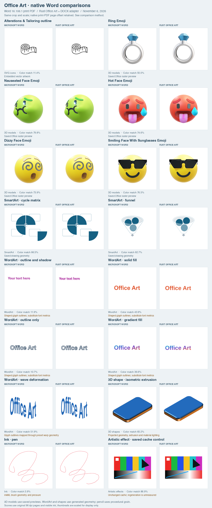
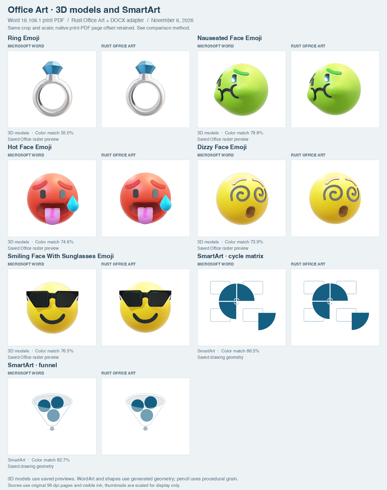
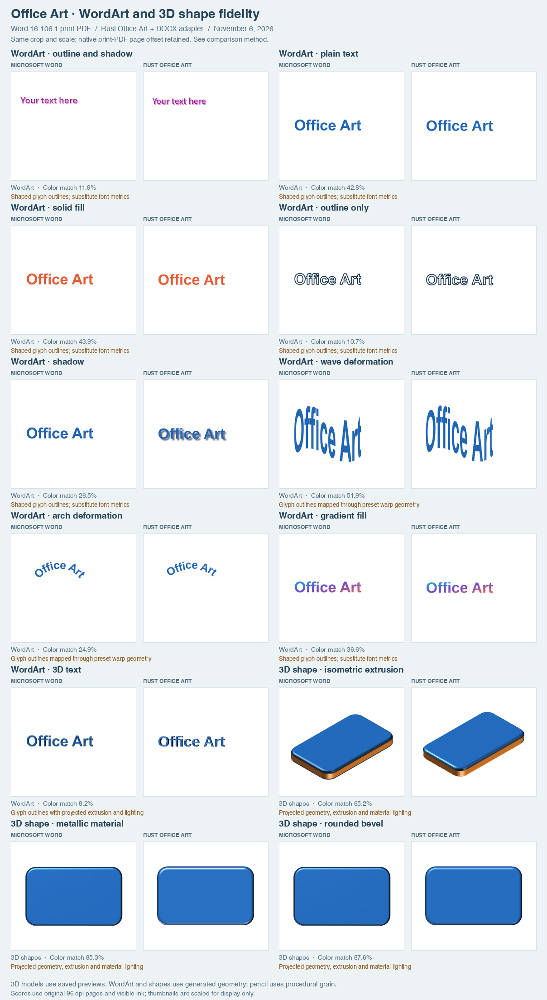
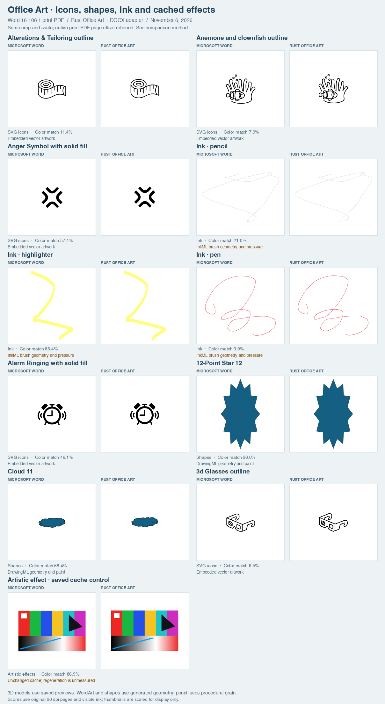

# Office Art comparisons

The main README's expanded gallery compares 30 drawing objects with Microsoft Word for Mac 16.106.1. The November 6, 2026 candidate uses the current native `rust-docx` adapter and shared `rust-office-art` renderer; Chromium displays the emitted SVGs and saved image assets. This is a renderer comparison, not a fresh React DOCX pagination benchmark or a claim of complete Office fidelity.



| Family | Cases | Rendering path |
| --- | ---: | --- |
| 3D models and emoji | 5 | Office's saved raster previews; embedded model data remains preserved |
| SmartArt | 2 | Saved geometry, fills, outlines and transforms |
| WordArt | 9 | Shaped glyph outlines, preset deformation paths, fill, outline, shadow and projected extrusion |
| 3D shapes | 3 | Projected geometry, front/back bevels, extrusion and material lighting |
| SVG icons | 5 | Embedded SVG artwork |
| Ordinary shapes | 2 | DrawingML preset geometry |
| Ink | 3 | Reconstructed InkML brush geometry, coordinates and pressure |
| Artistic effect cache | 1 | Unchanged bitmap with artistic metadata; no effect-regeneration claim |

The [picture/effect and shape matrices](picture-coverage.md) add 61 retained comparisons, including cropping, tiling, color operations, shadows, glow, soft edges, connectors and grouped transforms. The [SmartArt inventory](smartart-coverage.md) covers many more saved layout types but does not establish native pixel parity for them. The galleries cover feature families, not every preset, parameter combination, model format or Office version.

## 3D models and SmartArt



The five embedded models include four face emoji and a ring. The candidate displays the document's saved Office-rendered raster. Word can rerender the original GLB during export, so edge sampling and lighting may differ from the stored preview. Neither matching a preview nor preserving the GLB proves mesh-rendering or animation support. The two SmartArt diagrams use their saved drawing trees, including intentionally empty labels and edited geometry; no cached label is invented.

## WordArt and 3D shapes



The renderer now shapes portable fonts into glyph outlines, preserving kerning, ligatures, fractional sizes and measured advance widths. WordArt fitting uses these measurements instead of character-count estimates. Standard DrawingML text-warp guides produce either paired deformation envelopes or a baseline path; the renderer maps glyph geometry through those guides. Text fill, outline and shadow remain separate paint operations.

The shared 3D path renders shape and text contours with preset camera projection, extrusion, front/back bevels, light-rig directions and material response. Paint bounds include projected geometry outside the original layout frame. Unsupported combinations retain their original representation and warnings.

The [rendering notes](office-art-rendering-notes.md) record the targeted REA2 findings behind text mapping, material response and ink pressure, including their evidence boundaries.

Portable font substitution remains explicit: the renderer includes licensed Arimo, Carlito-derived, Tinos and Cousine outlines. It does not bundle proprietary Office fonts, so an Aptos request cannot establish identical glyph contours. The curved-text control remains approximately six pixels shorter than the native reference at 96 dpi. Native materials, antialiasing and shadows can also differ; all cases remain visible in the gallery and measurements.

## Icons, shapes, ink and artistic effects



SVG icon and ordinary shape rendering are separate from the 3D model path. Ink is reconstructed from the saved InkML, including declared coordinate resolution, differential trace encoding, brush dimensions, pressure and rectangular highlighter tips. It retains the original coordinate frame instead of fitting the trace to its bounds. Pencil grain is generated at 300 dpi and embedded in the SVG; its texture and soft edges remain an approximation of native rendering. The artistic picture contains an unchanged saved bitmap and effect metadata. Matching that bitmap demonstrates preservation only; it does not demonstrate applying the artistic effect to an original image.

## Measurement and reproduction

Each source drawing is placed on its own 816 × 1056 pixel page at a known page-relative anchor. Its geometry, model, diagram and image parts are preserved, and legacy fallback anchors move by the same amount. Additional WordArt and 3D shape probes come from the deterministic manual atlas. Word opened all 30 pages and exported a local PDF through **Print → PDF → Save as PDF**; Poppler Cairo rasterized that PDF at 96 dpi.

The native print route retains a small page-origin offset: unchanged drawings land approximately 1–2 pixels right and down compared with an earlier direct PDF export. Direct-export menu automation was unreliable for the corrected input, so the verified print reference is retained without compensating for that offset. Scores include this capture difference and should not be interpreted as renderer-only error. Both before and after candidates use the same corrected input and reference.

The same input is parsed by the native Rust example. `prepare-pages.py` places the model's images at their reported anchors and paint bounds, and Chromium captures those pages at device scale 1. Both columns use the same crop and display scale. The scores use the complete original pages: RGB agreement within 16 levels over the union of visible ink, with a 247 white threshold. White page margins cannot improve that score. No object is independently translated, resized or removed to improve agreement. The CSV includes before/after color agreement for every case.

Generate the fixed pages from a local source containing the retained drawing objects:

```sh
python3 scripts/image-fidelity/art-gallery.py --source INPUT.docx --output OUTPUT
cargo run -p rust-docx --example image_fidelity -- OUTPUT/office-art-gallery.docx OUTPUT/model.json
python3 scripts/image-fidelity/prepare-pages.py --directory OUTPUT --model OUTPUT/model.json
```

Export the original generated input from Word as `OUTPUT/word-reference.pdf`, record the exact export route, and rasterize and seal the reference:

```sh
mkdir -p OUTPUT/word-cairo-pages
pdftocairo -png -r 96 OUTPUT/word-reference.pdf OUTPUT/word-cairo-pages/page
python3 scripts/image-fidelity/art-gallery.py --record-reference --directory OUTPUT --word-version 16.106.1 --export-method 'Word Print > PDF > Save as PDF; Cairo at 96 dpi'
```

Serve `OUTPUT` locally and capture the prepared page through `prepare-capture.py --target parser` as described in the [capture workflow](../scripts/image-fidelity/README.md). Save the browser version and device scale in `OUTPUT/browser-version.log`. To retain before/after scores, render the same input with the baseline revision and place its captures in `OUTPUT/parser-before`. Then generate the galleries:

```sh
python3 scripts/image-fidelity/art-gallery.py --directory OUTPUT --candidate OUTPUT/parser-pages --model OUTPUT/model.json --output docs/readme-assets/word-officeart-expanded
```

[All 30 measurements](readme-assets/word-officeart-expanded-comparison.csv) · [Source, native reference, model, browser and image provenance](readme-assets/word-officeart-expanded-provenance.json)
